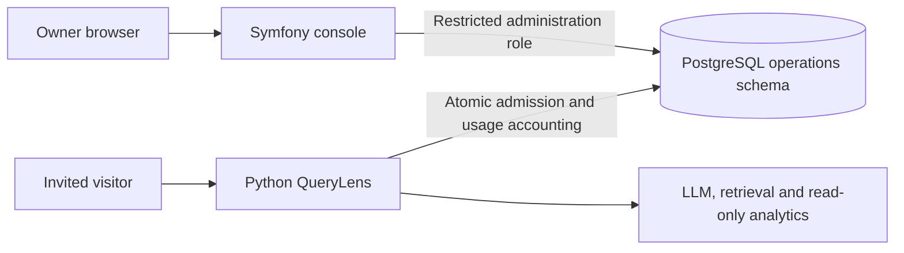

# Proposed console architecture

Status: design direction only. No application or integration is implemented.

## First-release boundary

The owner creates an invitation, privately shares its one-time-displayed link,
then inspects usage or edits/revokes it. The three main screens are invitation
list, create/edit and usage detail, plus administrative login and one-time secret
presentation. An invitation label is sufficient; separate company CRM is deferred.

Symfony is intended to use Security, Forms/Validator, Twig, dependency-injected
application services and Doctrine DBAL for existing operations tables. Use ORM
for genuinely console-owned entities only when needed. Version/package selection
belongs to milestone 1, after official compatibility checks.

## Proposed deployment and ownership

The starting proposal shares the existing PostgreSQL instance, with a new console
role and narrowly reviewed access. This is a deliberate shared-database design,
not a claim that the applications are independently deployable microservices.
Cross-repository database compatibility must be managed explicitly.

| Responsibility | Owner |
|---|---|
| Administrative authentication and forms | Symfony |
| Invitation creation, limit edits, expiry and revocation workflows | Symfony, compatible with existing Python owner CLI |
| Existing operations schema and its migrations | Python/Alembic |
| Visitor login/session creation, atomic admission and concurrency leases | Python |
| Post-request usage/cost recording and AI execution | Python |
| Usage display and administrative-action audit | Symfony |
| Explicit role provisioning and any schema migration | Owner job, outside both web runtimes |

Doctrine must exclude existing operations tables from schema generation and
migrations. If a console-only schema is introduced, document its single migration
owner and deployment order first. No schema or role is created in this phase.

## Runtime boundary

The Symfony runtime needs neither OpenAI credentials nor analytics/knowledge
readers nor PostgreSQL owner credentials. It cannot reset usage, alter global
policy, mutate completed accounting, remove leases or manufacture visitor sessions.
Administration and Python admission must follow the same transaction/locking
protocol; see [integration](integration.md).

An alternative is a private Python administrative HTTP API. It adds an explicit
network/authentication contract and a server-side administrative component that
does not exist today. Choose it only through a recorded decision; never assume
the public `/api/chat` service already exposes owner operations.

## Open decisions before implementation

1. Supported PHP/Symfony versions and the smallest required package set.
2. Confirm shared-DB integration or choose the private-API alternative.
3. Exact grants and constrained writes: reviewed SQL repositories versus
   database routines, with cross-language concurrency/ACL tests.
4. One owner login, password-hash provisioning, session storage and hosting access.
5. Administrative audit storage/migration ownership and mutation atomicity.
6. Safe one-time code delivery, POST refresh/double submission and lost responses.
7. Local disposable test topology, cross-repository CI and release coordination.

## Deferred extensions

Saved analytical reports can later become a separate feature using Symfony
HttpClient to call QueryLens. Background execution may justify Messenger only
then. Such work requires separate report permissions, content retention, service
credentials, quotas and paid-test allowances. No queue/worker/scheduler is needed
for the initial invitation console.
