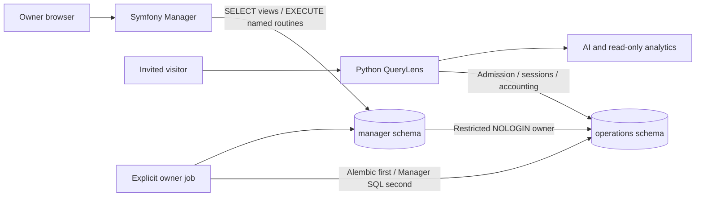

# Console architecture

Status: local implementation of milestones 1–3. Hosting remains unverified.
See [decisions](decisions.md) and [verification](verification.md).

## Product and boundaries

The owner signs in, creates a named invitation, privately copies its one-time
link, inspects sanitized usage, and edits lifetime limits/expiry or revokes it.
There is no registration, Company CRUD, public admin API, invitation deletion,
quota reset, provider execution, scheduler or worker.

PHP 8.5 / Symfony 7.4 uses Security, Forms/Validator, Twig and explicit application
services. Doctrine DBAL issues parameterized SQL to a restricted read/routine
boundary. ORM and Doctrine migrations are absent because Alembic owns operations.

The applications deliberately share a PostgreSQL ledger. This requires coordinated
schema releases and a pinned Python contract, not independent database ownership.
`manager.compatibility` verifies Alembic head on each new runtime connection;
unsupported heads fail closed. No migration, role grant or seed runs on startup.

| Responsibility | Implementation owner |
|---|---|
| Owner login, CSRF, session/attempt limits | Symfony Security and security listeners |
| Forms and operation intentions | Symfony controllers, InvitationOptions, OperationIntents |
| Invitation mutations and atomic audit | Three SECURITY DEFINER routines owned by a NOLOGIN role |
| Existing operations schema | Pinned Python/Alembic owner jobs |
| New manager schema/views/routines/audit | Explicit Manager SQL owner jobs |
| Visitor sessions, admission, concurrency, post-request usage | Python only |
| Read projections and pagination | InvitationReader and restricted SQL views |

All mutations acquire the existing transaction advisory lock `716202608` before
reading state. Paired initial rows, metadata changes and audit commit atomically.
Editing compares a metadata version to reject stale forms. Operation IDs make
successful replays harmless. First revocation time and every usage counter remain
preserved; already admitted Python work can finish after revocation.

The creation response renders plaintext only after commit. Its session contains
public operation IDs and CSRF data only. A replay/lost response cannot recover a
secret and cannot silently issue a second invitation. See [security](security.md).

## Source map

- `src/Security`: owner configuration/provider, login limiter, idle timeout, origin/headers.
- `src/Invitation`: validated options, code/link generation, intentions and DBAL services.
- `src/Controller`, `src/Form`, `templates`: authenticated HTTP workflows and escaped UI.
- `src/Infrastructure`: lazy dedicated-role connection and compatibility guard.
- `database`: explicit, versioned owner jobs; no operations-table DDL.
- `tests`: unit/HTTP, PostgreSQL permission and pinned Python contract checks.

## Remaining operational work

Choose hosting, production HTTP/PHP serving, TLS/proxy mapping and private persistent
storage. Verify secure cookies, restart/session behavior, owner audit and PHP-issued
login in the hosted Python UI. The development server is not a production runtime.
The local tests and CI definition do not establish hosted acceptance.
